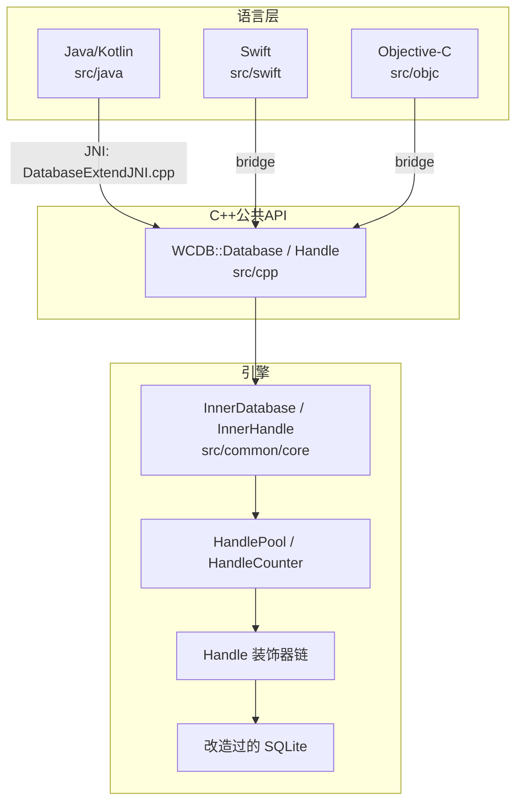

# 01 总览：WCDB 与裸 SQLite 差在哪

- **本课目标**：建立 WCDB 整体认知，看清五语言共用一套 C++ 核心的分层。
- **前置**：无。
- **预计用时**：30 分钟。
- **承接上节**：这是第一课，直接开始。
- **本课要弄懂：WCDB 与裸 SQLite 差在哪？五种语言怎么共用一套核心？**
- **预告下节**：分层清楚了，下节看 `Database`/`Handle`/`Statement` 这三层的内部关系。

## 一、WCDB 的定位

WCDB 不是「另一个数据库引擎」，而是**SQLite 之上的一层封装 + SQLite 本身的一次深度改造**：

| 维度 | 裸 SQLite | WCDB |
| --- | --- | --- |
| SQL 写法 | 手写字符串拼接 | ORM + WINQ 类型安全链式 API |
| 并发 | 一个 `sqlite3*` 一把锁 | **连接池多 handle**，多线程读写并发 |
| 表结构升级 | 手动 `ALTER` | `AutoMigrate` 自动迁移 |
| 空间回收 | 手动 `VACUUM` | `AutoVacuumConfig` 自动触发 |
| 锁竞争 | 自己处理 `SQLITE_BUSY` | `BusyRetryConfig` 自动重试 |
| 加密 | 要自己接 SQLCipher | `CipherConfig` 一行配置 |
| 大字段存储 | 原样存 | Zstd **字段级压缩**（`AutoCompressConfig`） |
| 库坏了 | 基本没救 | `common/core/repair/` RepairKit 自动修复 |

README 把能力分成四块：**Easy-to-use**（ORM/WINQ）、**Efficient**（多线程连接池 + 批量写入优化）、
**Complete**（加密/修复/防注入/升级/全文检索/迁移/压缩）、**Compatibility**（五大语言）。

## 二、五语言一套核心（图 1-1）

> 图 1-1：所有语言最终都落到 `src/cpp` 的公共 API，再进 `src/common/core` 的引擎实现。
> Java 通过 `src/java/main/src/main/cpp/core/DatabaseExtendJNI.cpp` 把 `Database`/`Handle` 的每个方法
> 转成 `static native` 调用；Swift/ObjC 走 `src/bridge` 桥接层。

**这套分层带来的两个直接结果**：

1. **能力不分裂**——加密、压缩、自动 vacuum 在 C++ 实现一次，五语言都能用；
2. **语言层很薄**——Java 侧 `Database.java` 几乎每个方法都是
   `public void xxx(...) { xxx(cppObj, args); }` + `private static native long xxx(long self, ...)`，
   没有第二套逻辑。

## 三、源码分层（自上而下）

| 层 | 目录 | 关键类 |
| --- | --- | --- |
| 语言层 | `src/java/main/.../core/` | `Database`、`Handle`、`PreparedStatement`、`Table`、`Transaction` |
| C++ 公共 API | `src/cpp/core/` | `Database`、`Handle`、`PreparedStatement`、`Table`（都 `final`） |
| 链式 DSL | `src/cpp/chaincall/` | `ChainCall`、`Select`、`Insert`、`Update`、`Delete`、`MultiSelect` |
| 内部引擎 | `src/common/core/` | `InnerDatabase`、`InnerHandle`、`HandlePool`、`HandleCounter` |
| SQLite 适配 | `src/common/core/sqlite/` | `AbstractHandle`、`DecorativeHandle`（装饰器基类） |
| 扩展能力 | `src/common/core/{repair,cipher,compression,migration,integrity,vacuum}/` | 各能力一个目录 |
| 表结构生成 | `src/java/builder/compiler/` | `JavaAnnotationProcessor` + `JavaCodeGenerator` |

> 注意 `src/cpp/core/*.hpp` 里 `Database`、`Handle`、`PreparedStatement` 都是 `final` 类——
> 公共 API 明确**不允许继承**，扩展只能通过配置（见 04 课）与装饰器（见 03 课）。

## 四、和「已学过的数据库类库」怎么区分

- **Room**（Google）：编译期生成 DAO，运行时仍是**单库单锁**，靠 `allowMainThreadQueries` 之类规避并发；
  WCDB 的差异化在于**运行时多 handle 连接池**（03 课细讲）。
- **MMKV**：KV 存储，不做 SQL；WCDB 是关系型。
- WCDB 的 ORM 是**注解 + 编译期生成**（`@WCDBTableCoding` → 同包编码类，如 `TestObject` →
  `DBTestObject`，见 99 课），与 Room 的
  `@Entity` 思路一致，但生成的是 WINQ 语句构造器而非 DAO。

## 自测题

1. 列出 WCDB 相对裸 SQLite 至少 5 项增强能力，并说明它们分别由 `src/common/core/` 下的哪个目录实现。
2. Java 侧 `Database.java` 为什么几乎没有业务逻辑？它和 C++ 的 `WCDB::Database` 是什么关系？
3. `src/cpp/core/` 里 `Database`/`Handle`/`PreparedStatement` 都声明为 `final`，这对使用者意味着什么？
4. （动手）在 `src/` 下确认 `cpp/`、`java/`、`swift/`、`objc/`、`bridge/` 五个目录都存在，
   并找到 Java 到 C++ 的 JNI 实现文件（提示：`src/java/main/src/main/cpp/`），说明它由哪些
   `native` 方法组成。