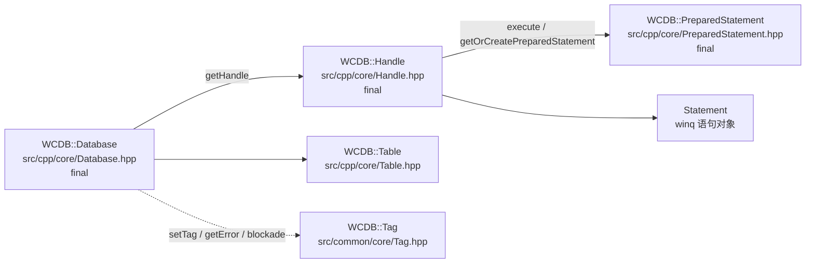

# 02 核心架构：Database / Handle / Statement 三层

- **本课目标**：吃透 C++ 公共 API 的三个核心类型、懒初始化，以及事务接口。
- **前置**：[01 总览](01-overview.md)。
- **预计用时**：45 分钟。
- **承接上节**：01 讲了五语言共用一套核心，下节开始看这套核心本身怎么组织。
- **本课要弄懂：三个核心类怎么分层？懒初始化怎么运作？**
- **预告下节**：Handle 只是「一张票」，下节看票背后的连接池与装饰器链。

## 一、三层关系（图 2-1）



> 图 2-1：`Database` 是库的唯一入口，`getHandle()` 拿一次执行上下文，`Handle` 上跑
> `Statement`；`Table` 提供建表/迁移；`Tag` 用于错误分类。

`WCDB::Database` 的关键声明（`src/cpp/core/Database.hpp`）：

```cpp
class WCDB_API Database final : public HandleORMOperation {
    /**
     @note  All database objects with same path share the same core.
           WCDB will not generate a sqlite db handle until the first operation,
           which is also called as lazy initialization.
     @warning Once a database is opened in read-only mode, it cannot be writable
              in the current process any more.
     */
    Database(const UnsafeStringView &path, bool readOnly = false);
    static Database createInMemoryDatabase();
    Handle getHandle();
    bool canOpen() const;
    bool isOpened() const;
    const Error &getError() const;
    void setTag(const long &tag);
};
```

四个要点：

1. **同路径共享内核**——多个 `Database` 对象指向同一个 `InnerDatabase`（`DatabasePool` 管理，见 03 课）；
2. **懒初始化**——构造 `Database` 不打开文件，第一次操作才创建 `sqlite3*`，所以 `canOpen()`
   要单独检查；
3. **只读不可逆**——进程内一旦以只读打开，之后无法写；
4. **`getError()` 按线程返回**——文档明确建议用 `traceError()` 回调统一收日志，而不是每个
   操作后手动取。

## 二、Handle：一次执行的上下文

`Handle` 是 `sqlite3*` 的包装，同时实现 `StatementOperation` + `HandleORMOperation`
（所以既能跑 SQL 也能跑 ORM 语句）：

```cpp
class WCDB_API Handle final : public StatementOperation, public HandleORMOperation {
    Handle(RecyclableHandle handle);                       // 从连接池拿到「票」
    InnerHandle* getOrGenerateHandle(bool writeHint = false);
    RecyclableHandle getHandleHolder(bool writeHint) override final;
    void invalidate();                                      // 归还到池子
    long long getLastInsertedRowID();                      // sqlite3_last_insert_rowid
    int getChanges();                                       // sqlite3_changes
    void attachCancellationSignal(const CancellationSignal& signal);
    void detachCancellationSignal();
    class CancellationSignal { void cancel(); };            // 配合 sqlite3_progress_handler
};
```

`Handle.cpp` 里每个操作都走同一个宏，先拿再放：

```cpp
#define GetInnerHandleOrReturnValue(value) \
    InnerHandle* handle = getOrGenerateHandle(); \
    if (!handle) return value;
```

**`invalidate()` 不是析构**——它是把内部 sqlite handle 归还连接池；池子满了或数据库被
`blockade()` 时会直接断言失败，所以拿出来的 `Handle` 用完必须 `invalidate()`。

**`CancellationSignal`** 是对 `sqlite3_progress_handler` 的封装：跨线程 `cancel()` 可以
中断长事务/长查询，但注释强调 **handle 只能在拿到它的那个线程里用**。

## 三、PreparedStatement：三种准备方式

Java 侧 `Handle.java` 的注释把三种方式的差别写得很清楚，这正是 SQLite 使用中最容易踩的点：

| 方法 | 行为 | 何时用 |
| --- | --- | --- |
| `getOrCreatePreparedStatement(Statement/String)` | 内部**缓存**语句，同 SQL 复用同一个 `sqlite3_stmt` | 常规 CRUD，最高效 |
| `prepareNewStatement(Statement/String)` | 每次新建 `sqlite3_stmt`，**不缓存**；可多个同时活跃 | Android Cursor 式交错查询 |
| `preparedWithMainStatement(Statement/String)` | 占用**主语句槽位** | 一次只能一条，用完释放 |

```java
// 注意 prepareNewStatement 的文档：
// "Unlike Handle#getOrCreatePreparedStatement(Statement), the statement will NOT be cached internally.
//  Unlike Handle#preparedWithMainStatement(Statement), multiple such statements can be active at the same time.
//  You MUST call Handle#finalizeAndReturnPreparedStatement(PreparedStatement) when done."
```

**必须配对 `finalizeAndReturnPreparedStatement`**，否则该 handle 的语句资源不会归还。

## 四、事务：接口 + 底层三件套

Java 侧事务是一个**函数式接口**：

```java
// src/java/main/src/main/java/com/tencent/wcdb/core/Transaction.java
public interface Transaction {
    /**
     * Triggered when a new transaction is begun successfully.
     * @return true to commit transaction.
     * @throws WCDBException if any error occurs.
     */
    boolean insideTransaction(@NotNull Handle handle) throws WCDBException;
}
```

调用方写 `database.execute(handle -> { ... return true; })` 这类形式，框架负责
begin/commit/rollback；返回 `false` 即回滚。另有 `PausableTransaction.java` 支持「暂停」语义
（把子事务拆成可暂停块）。

底层实现在 `src/common/core/sqlite/AbstractHandle.hpp`：

```cpp
#pragma mark - Transaction
virtual bool beginTransaction();
bool commitOrRollbackTransaction();
virtual bool commitTransaction();
virtual void rollbackTransaction();
enum class TransactionError { ... };
```

`InnerDatabase.cpp` 里 `beginTransaction()` 会先 `getOrGenerateHandle()` 再转发给
`AbstractHandle::beginTransaction()`，因此**事务是绑定在 handle 上的**，不是全局状态——
这也解释了为什么多线程下每线程要有自己的 handle（03 课）。

> Java 侧 `StatementBegin` 还支持三种事务级别
> （`TransactionType.Deferred = 0 / Immediate = 1 / Exclusive = 2`），
> 对应 SQLite 的 `BEGIN DEFERRED/IMMEDIATE/EXCLUSIVE`。

## 五、Database.close() 的四步

`Database.hpp` 的注释把关闭流程写得很清楚，这是理解并发模型的关键：

> 1. **blockade** — 阻塞所有新操作；
> 2. **close** — 等所有 sqlite handle 归还并关闭它们；
> 3. **onClosed** — 触发回调；
> 4. **unblokade** — 解除阻塞。

`blockade()` / `unblockade()` / `isBlockaded()` 在 `HandlePool` 上也有同名方法
（`src/common/core/HandlePool.hpp`）。文档明确警告：第 2 步会等所有 handle 归还，
**如果某个 handle 没 `invalidate()`，close 会死等**。

## 自测题

1. `WCDB::Database` 的懒初始化体现在哪两处 API 上？为什么要设计成懒的？
2. `Handle::invalidate()` 和析构函数有什么区别？漏调会怎样？
3. 三种语句准备方式各适合什么场景？`prepareNewStatement` 为什么必须配对 finalize？
4. 事务为什么「绑定在 handle 上」而不是数据库全局？这和 03 课的多 handle 模型有什么关系？
5. （动手）在 `src/cpp/core/Database.hpp` 里找到 `close()` 的四步说明与 `ClosedCallback` 类型，
   并对照 `src/common/core/HandlePool.hpp` 确认 `blockade()`/`drain()` 是否都有对应实现。