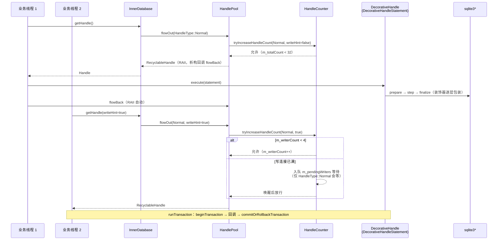

# 03 并发模型：连接池、槽位与装饰器链

- **本课目标**：弄懂 WCDB 的多线程模型——`HandlePool` 如何发「票」、`HandleCounter` 如何防写饥饿、装饰器链如何在不改核心代码的前提下挂加密/压缩等行为。
- **前置**：[02 核心架构](02-core-architecture.md)。
- **预计用时**：60 分钟。
- **源码**：`src/common/core/HandlePool.{hpp,cpp}`、`HandleCounter.{hpp,cpp}`、`InnerDatabase.cpp`、`InnerHandle.{hpp,cpp}`、`CoreConst.h`、`sqlite/DecorativeHandle.{hpp,cpp}`。
- **承接上节**：02 课结尾提到 `Database.close()` 会「等所有 handle 归还」。那这些 handle 是谁在管、并发怎么排队、装饰器怎么挂——都是本课的问题。
- **本课要弄懂：连接池怎么发票、写饥饿怎么防、装饰器链怎么挂行为？**
- **预告下节**：池子只是骨架，下节看挂上去的配置项——忙重试、自动 vacuum、加密、压缩。

## 一、为什么不能只留一个 `sqlite3*`

SQLite 一把库锁：同一时刻只有**一个写者**，读与写互斥。如果整个进程共用一个 `sqlite3*`，那么多线程下所有写操作都要串行等这把锁，`SQLITE_BUSY` 会直接冒出来。

WCDB 的做法是**连接池**：一个库路径对应一个 `HandlePool`，池子里可以同时存在多个 `sqlite3*`，用**槽位（slot）+ 类别（category）**分池管理；池子上限由两个常量封顶：

```cpp
// src/common/core/CoreConst.h
static constexpr const int HandlePoolMaxAllowedNumberOfHandles = 32;
static constexpr const int HandlePoolMaxAllowedNumberOfWriters = 4;
```

## 二、HandleType：一个枚举编码出「槽位 + 类别」

```cpp
// src/common/core/CoreConst.h
enum HandleSlot : unsigned char {
    HandleSlotNormal = 0,
    HandleSlotAutoTask,
    HandleSlotAssemble,
    HandleSlotVacuum,
    HandleSlotCipher,
    HandleSlotCount,
};

enum class HandleType : unsigned int {
    Normal         = (HandleCategoryNormal << 8) | HandleSlotNormal,
    Assemble       = (HandleCategoryNormal << 8) | HandleSlotAssemble,
    AssembleCipher = (HandleCategoryCipher << 8) | HandleSlotCipher,
    AssembleBackup = (HandleCategoryBackup << 8) | HandleSlotAssemble,
    Vacuum         = (HandleCategoryVacuum << 8) | HandleSlotVacuum,
    AutoVacuum     = (HandleCategoryVacuum << 8) | HandleSlotAutoTask,
    ...
};
static constexpr HandleSlot slotOfHandleType(HandleType type)
{
    return HandleSlot(((unsigned int) type) & 0xff);
}
static constexpr HandleCategory categoryOfHandleType(HandleType type)
{
    return HandleCategory(((unsigned int) type >> 8) & 0xff);
}
static constexpr bool handleShouldWaitWhenFull(HandleType type)
{
    return type == HandleType::Normal;
}
```

两个关键设计：

- **高位是 category，低位是 slot**，`HandleType` 一个枚举同时表达「干什么活」和「进哪个池」；
- `handleShouldWaitWhenFull` **只对 `HandleType::Normal` 返回 true**——只有普通读写业务会在池满时排队等；自动任务（备份、压缩、迁移、checkpoint）池满就直接失败返回。这样后台维护任务永远不会把业务线程堵死。

## 三、`HandlePool::flowOut`：一次取票的完整流程

```cpp
// src/common/core/HandlePool.hpp
class HandlePool : public ThreadedErrorProne {
public:
    void blockade();                 // 阻塞所有新操作（close 第 1 步）
    bool isBlockaded() const;
    void unblockade();               // close 第 4 步解除
    typedef std::function<void(void)> DrainedCallback;
    void drain(const HandlePool::DrainedCallback &onDrained);

protected:
    mutable SharedLock m_concurrency;

public:
    typedef unsigned int Slot;
    RecyclableHandle flowOut(HandleType type, bool writeHint = false, bool threaded = false);
    void purge();
};
```

`flowOut` 的三段逻辑（`HandlePool.cpp`）：

```cpp
RecyclableHandle HandlePool::flowOut(HandleType type, bool writeHint, bool threaded)
{
    HandleSlot slot = slotOfHandleType(type);
    HandleCategory category = categoryOfHandleType(type);

    ReferencedHandle &referencedHandle = m_threadedHandles.getOrCreate().at(category);
    // threaded handles is thread safe.
    if (referencedHandle.handle != nullptr) {
        ++referencedHandle.reference;
        return RecyclableHandle(
            referencedHandle.handle,
            std::bind(&HandlePool::flowBack, this, type, std::placeholders::_1));
    }

    if (!m_counter.tryIncreaseHandleCount(type, writeHint)) {
        ...  // 超限：setThreadedError + 返回空
    }
    ...
}
```

要点：

1. **线程内 handle 优先复用**——`m_threadedHandles` 是线程局部存储，同一线程第二次拿票直接命中，且引用计数自增；`RecyclableHandle` 析构时自动回调 `flowBack` 归还，属于 **RAII**。
2. **`flowBack` 是归还唯一出口**，把计数递减、槽位释放都收口在一处；
3. 拿不到票时**不抛异常**，而是 `setThreadedError` 后返回空 handle——上层 `Handle::getOrGenerateHandle()` 拿到空就提前 return，Java 侧表现为 `WCDBException`。

> `threaded = true` 的调用（例如「必须跑在当前线程已有 handle 上」的操作）在命中失败时**直接返回空**，不去新开连接——避免跨线程共享 `sqlite3*`。

## 四、`HandleCounter`：写饥饿的防线

池子上限 32，但**写连接单独限制为 4**，并且排队规则不对称：

```cpp
// src/common/core/HandleCounter.cpp
bool HandleCounter::tryIncreaseHandleCount(HandleType type, bool writeHint)
{
    std::unique_lock<std::mutex> lockGuard(m_lock);
    while (m_totalCount >= HandlePoolMaxAllowedNumberOfHandles
           || (writeHint && m_writerCount >= HandlePoolMaxAllowedNumberOfWriters)) {
        while (m_totalCount >= HandlePoolMaxAllowedNumberOfHandles) {
            if (!handleShouldWaitWhenFull(type)) {
                return false;                  // 非 Normal：不排队，直接失败
            }
            m_pendingNormals.push_back(Thread::current());
            m_conditionalNormals.wait(lockGuard);
            m_pendingNormals.pop_front();
        }
        while (writeHint && m_writerCount >= HandlePoolMaxAllowedNumberOfWriters) {
            if (!handleShouldWaitWhenFull(type)) return false;
            m_pendingWriters.push_back(Thread::current());
            m_conditionalWriters.wait(lockGuard);
            m_pendingWriters.pop_front();
        }
    }
    if (writeHint) m_writerCount++;
    m_totalCount++;
    return true;
}

void HandleCounter::decreaseHandleCount(bool writeHint)
{
    std::unique_lock<std::mutex> lockGuard(m_lock);
    if (writeHint) {
        m_writerCount--;
        if (m_pendingWriters.size() > 0) {
#ifdef __APPLE__
            m_conditionalWriters.notify(m_pendingWriters.front());   // 精准唤醒队头
#else
            m_conditionalWriters.notify_all();
#endif
            hasNotified = true;
        }
    }
    m_totalCount--;
    if (!hasNotified && m_pendingNormals.size() > 0) { ... }
}
```

三个细节值得记住：

- **等待队列是 FIFO**（`std::list<Thread> m_pendingNormals/m_pendingWriters`），后到的写者不会插队——这是防写饥饿的核心；
- Apple 上用 `notify_one` 精准唤醒**队头**线程，非 Apple 平台 `notify_all()`，行为等价但唤醒面更大；
- `m_writerCount` / `m_totalCount` 只在 `m_lock` 保护下增减，所以并发下计数不会错乱。

> 「为什么写连接只给 4 个」：写事务本身在 WAL 模式下就是串行提交，开太多写连接只会增加 `busy` 与锁升级开销，4 个足够覆盖典型的读写混合并发。

## 五、事务为什么绑定在 handle 上

SQLite 的事务状态是**连接级别**的（`BEGIN` 作用在当前 `sqlite3*` 上），所以 WCDB 的事务也必然绑定 handle。C++ 侧的实现在 `InnerHandle`：

```cpp
// src/common/core/InnerHandle.hpp
#pragma mark - Transaction
public:
    typedef std::function<bool(InnerHandle *)> TransactionCallback;
    typedef std::function<bool(InnerHandle *, bool &, bool)> TransactionCallbackForOneLoop;

    bool runTransaction(const TransactionCallback &transaction);
    bool runTransactionIfNotInTransaction(const TransactionCallback &transaction);
    bool runPausableTransactionWithOneLoop(const TransactionCallbackForOneLoop &transaction);
```

```cpp
// src/common/core/InnerHandle.cpp
bool InnerHandle::runTransaction(const TransactionCallback &transaction)
{
    if (beginTransaction()) {
        if (transaction(this)) {
            return commitOrRollbackTransaction();
        } else {
            rollbackTransaction();
        }
    }
    return false;
}
```

`runTransactionIfNotInTransaction` 在**已有事务时直接执行回调**（因为回调里返回 `false` 也会让外层事务回滚），这就是**嵌套事务/保存点**的入口。真正的保存点在 `AbstractHandle::commitTransaction()`：

```cpp
// src/common/core/sqlite/AbstractHandle.cpp
bool AbstractHandle::commitOrRollbackTransaction()
{
    bool succeed = true;
    if (m_transactionError != TransactionError::Fatal) {
        succeed = commitTransaction();
    } else {
        succeed = false;
    }
    if (!succeed) {
        rollbackTransaction();       // 事务失败时回滚
        succeed = false;
    }
    return succeed;
}

bool AbstractHandle::commitTransaction()
{
    bool succeed = true;
    if (m_transactionLevel > 1) {                       // 子事务 → RELEASE savepoint
        if (m_transactionError == TransactionError::Allowed && isInTransaction()) {
            succeed = executeStatement(
                StatementRelease().release(getSavepointName(m_transactionLevel)));
            ...
```

也就是说 WCDB 用 `m_transactionLevel` 把「嵌套事务」翻译成 SQLite 的 `SAVEPOINT`/`RELEASE`，而不是真的开多个事务。

`PausableTransaction`（`runPausableTransactionWithOneLoop`）用于**批量写入被 busy 打断后续跑**：

```cpp
bool InnerHandle::runPausableTransactionWithOneLoop(const TransactionCallbackForOneLoop &transaction)
{
    bool stop = false;
    bool needBegin = true;
    bool isNewTransaction;
    do {
        isNewTransaction = needBegin;
        if (needBegin && !beginTransaction()) return false;
        needBegin = false;
        if (!transaction(this, stop, isNewTransaction)) { rollbackTransaction(); return false; }
        if (checkMainThreadBusyRetry() || stop) {
            if (!commitOrRollbackTransaction()) return false;
            if (!stop) {
                needBegin = true;                       // 下一轮重新 BEGIN
                std::this_thread::sleep_for(std::chrono::microseconds(100));
            }
        }
    } while (!stop);
    return true;
}
```

## 六、装饰器链：不改核心代码挂上加密与压缩

WCDB 的 handle 不是单一类，而是一条**可替换的继承链**：

```
AbstractHandle（sqlite3* 的薄封装，src/common/core/sqlite/AbstractHandle.hpp）
    └── InnerHandle（事务、语句生命周期，src/common/core/InnerHandle.hpp）
            ├── DecorativeHandle（装饰器基类，sqlite/DecorativeHandle.hpp）
            │        └── CipherHandle（加密，common/core/cipher/CipherHandle.hpp）
            └── ConfiguredHandle final（最普通、无任何装饰的 handle）
```

**handle 到底 new 哪个类**由 `InnerDatabase::generateSlotedHandle` 按槽位决定：

```cpp
// src/common/core/InnerDatabase.cpp
std::shared_ptr<InnerHandle> InnerDatabase::generateSlotedHandle(HandleType type)
{
    HandleSlot slot = slotOfHandleType(type);
    std::shared_ptr<InnerHandle> handle;
    switch (slot) {
    case HandleSlotNormal:
    case HandleSlotAutoTask:
        handle = std::make_shared<DecorativeHandle>();
        break;
    case HandleSlotCipher:
        handle = std::make_shared<CipherHandle>();
        break;
    default:
        WCTAssert(slot == HandleSlotAssemble || slot == HandleSlotVacuum);
        handle = std::make_shared<ConfiguredHandle>();
        break;
    }
    ...
    if (!setupHandle(type, handle.get())) return nullptr;
    return handle;
}
```

注意 `DecorativeHandle` **不是**给每个 handle 都套一层，而是**基类**——加密库直接用 `CipherHandle`，普通库用 `DecorativeHandle`，内部维护任务用裸 `ConfiguredHandle`。三者共享 `InnerHandle` 的事务/语句逻辑，区别只在「装饰函数表」。

### 6.1 装饰器是怎么「装饰」的

`DecorativeHandle` 继承 `DecorativeClass<HandleFuncType, Count>`（来自 `src/common/base/ClassDecorator.hpp`），本质是一张**函数指针表**：每个可被装饰的底层调用（`prepare`/`step`/`commitTransaction`/`executeSQL`…）都有一个槽位，默认指向基类实现，装饰器把某个槽位替换掉即可：

```cpp
// src/common/core/sqlite/DecorativeHandle.hpp
class DecorativeHandle
    : public DecorativeClass<HandleFuncType, (unsigned char) HandleFuncType::Count>,
      public InnerHandle {
public:
    void onDecorationChange() override final;
    void initDecorativeFunctions() override final;

public:
    template<typename Operator, typename... Args>
    Operator &getOrCreateOperator(const UnsafeStringView &name, const Args &...args)
    {
        static_assert(std::is_base_of<HandleOperator, Operator>::value, "");
        auto iter = m_operators.find(name);
        if (iter != m_operators.end()) {
            return *(static_cast<Operator *>(iter->second.get()));
        } else {
            std::shared_ptr<HandleOperator> newOperator
                = std::make_shared<Operator>(this, args...);
            m_operators.emplace(name, newOperator);
            return *(static_cast<Operator *>(newOperator.get()));
        }
    }
};
```

同一套机制在**语句级别**再来一遍：`DecorativeHandleStatement` 继承
`HandleStatement` + `DecorativeClass<HandleStatementFuncType, Count>`，重写
`prepare/finalize/step/reset/clearBindings/bindInteger/bindDouble/bindText/bindBLOB/...`。
所以一个 handle 上有**两层装饰器**：handle 级 + statement 级。

**Operator 就是装饰器挂载的载体**。`InnerDatabase` 里全是同一个套路：

```cpp
// src/common/core/InnerDatabase.cpp
auto &compressOperator
    = handle.getDecorative()->getOrCreateOperator<CompressHandleOperator>(OperatorCompress);
auto &migrateOperator
    = handle.getDecorative()->getOrCreateOperator<MigrateHandleOperator>(OperatorMigrate);
auto &backupOperator
    = backupHandle.getDecorative()->getOrCreateOperator<Repair::BackupHandleOperator>(OperatorBackup);
```

`HandleOperator` 子类一共六七个，各自再兼一个 Delegate 角色：
`AssembleHandleOperator`（`assemble/`）、`VacuumHandleOperator`（`vacuum/`）、
`CompressHandleOperator`（`compression/`）、`IntegerityHandleOperator`（`integrity/`）、
`MigrateHandleOperator`（`migration/`）、`BackupHandleOperator`（`repair/mechanic/`）。
`getOrCreateOperator` 按名字懒创建、用 `shared_ptr` 持有在 `m_operators` 里。这就是「自动压缩」
「自动迁移」能在**不改 `InnerHandle` 一行代码**的前提下接入的原因。

> 加密是**另一条路**：`CipherHandle final : public InnerHandle, public Repair::CipherDelegate`
> 直接重写了 `execute(const Statement&)` 与 `setCipherKey`，不走 Operator。它对应
> `HandleSlotCipher` 槽位，见下面第六节。

### 6.2 语句也走装饰器

```cpp
// src/common/core/sqlite/DecorativeHandleStatement.hpp
class DecorativeHandleStatement final
    : public HandleStatement,
      public DecorativeClass<HandleStatementFuncType, (unsigned char) HandleStatementFuncType::Count> {
public:
    bool prepare(const Statement &statement) override final;
    void finalize() override final;
    bool step() override final;
    ...
};
```

`InnerHandle` 的主语句就是它：

```cpp
// src/common/core/InnerHandle.cpp
InnerHandle::InnerHandle()
    : ..., m_mainStatement(nullptr)
{
    m_mainStatement = getStatement();       // 从语句池取一个 DecorativeHandleStatement
}
InnerHandle::~InnerHandle()
{
    returnStatement(m_mainStatement);      // 归还语句池
}
```

`InnerHandle::execute(const Statement &)` 全程只操作 `m_mainStatement`：

```cpp
bool InnerHandle::execute(const Statement &statement)
{
    bool succeed = false;
    if (prepare(statement)) {
        succeed = step();
        finalize();
    }
    return succeed;
}
```

也就是说 02 课讲的「主语句」在这里落地了：每个 handle 一个 `m_mainStatement`，`prepare → step → finalize` 三步，装饰器把每步包在外面。

## 七、一图串起来（图 3-1）



> 图 3-1：一次「取票—执行—归还」的时序。`HandleCounter` 是唯一的并发闸门，
> 装饰器链只影响**怎么执行**，不影响**谁能拿票**。

## 常见坑

1. **拿票后忘了 invalidate / 让 RAII 兜底**：`Handle` 是值类型，跨作用域传递时必须确保析构会触发 `flowBack`；否则该线程的 threaded handle 一直占着槽位，`flowOut` 永远复用旧连接，`purge()` 也回收不了。
2. **以为「事务 = 数据库级」**：SQLite 事务是连接级。同一个 `Database` 上，两个线程各拿一个 handle 各自 `BEGIN`，是**两个独立事务**。想跨线程一致，用 `blockade()` + 显式串行。
3. **在后台任务里期待「等一等就有名额」**：`handleShouldWaitWhenFull` 只对 `HandleType::Normal` 为 true。`AssembleBackup`/`Vacuum` 这些槽位池满直接返回失败，不会阻塞。
4. **加密库拿到普通 handle**：加密 handle 必须走 `HandleSlotCipher` 槽位拿到的 `CipherHandle`
   （它自己重写了 `execute`/`setCipherKey`），普通槽位拿到的是 `DecorativeHandle`——
   用它去读写加密库，装饰器链里没有 cipher 分支，必然失败。
5. **想自己继承 `InnerHandle` 加行为**：继承链是封死的——`ConfiguredHandle` 是 `final`，
   `DecorativeHandle`/`CipherHandle` 也是，`HandlePool` 只按槽位 new 这三类。扩展点只有
   Operator（`HandleOperator` 子类）与装饰器函数表，没有「新 handle 类」这条路。

## 自测题

1. `HandlePoolMaxAllowedNumberOfHandles` 与 `HandlePoolMaxAllowedNumberOfWriters` 分别是多少？后者为什么远小于前者？
2. `HandleType::Normal` 和 `HandleType::AssembleBackup` 在池满时的行为差异，由哪个函数决定？它的实现只有一行，是什么？
3. `HandleCounter::tryIncreaseHandleCount` 里为什么写连接判满要在**外层 while** 与**内层 while** 各判一次？
4. 为什么 `RecyclableHandle` 的归还函数是 `flowBack` 而不是析构里直接减计数？请结合 `m_threadedHandles` 的引用计数解释。
5. `DecorativeHandle` 与 `ConfiguredHandle` 都由 `generateSlotedHandle` 创建，分别在哪些 `HandleSlot` 下创建？各自适合什么场景？
6. `getOrCreateOperator<Operator>(name, args...)` 里 `static_assert` 检查什么？为什么 `m_operators` 用 `std::shared_ptr<HandleOperator>` 而不是裸指针？
7. （动手）在 `src/common/core/CoreConst.h` 里数一数 `HandleType` 一共多少个枚举值，其中哪些落在 `HandleSlotCipher` 槽位？
8. （动手）写一段伪代码：线程 A 做读事务、线程 B 做写事务、线程 C 是 `AutoVacuum` 任务同时 `flowOut`，说明三者拿到的 handle 是否可能相同，以及并发上限各自受什么约束。
