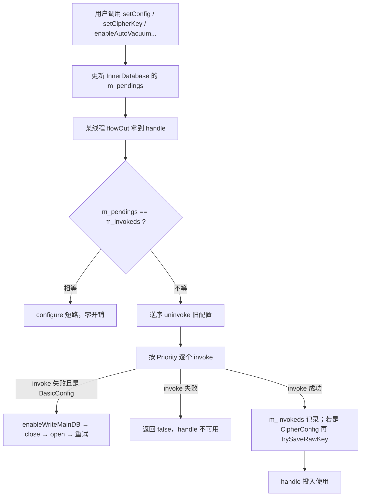

# 04 配置系统：Config、Priority 与自愈能力

- **本课目标**：搞清 WCDB 的「配置」到底是什么——`Config` 基类 + 优先级 + 懒生效算法，以及自动 vacuum / checkpoint / 备份 / 迁移 / 压缩 / 加密这些自愈能力是怎么挂上去的。
- **前置**：[03 并发模型](03-concurrency.md)。
- **预计用时**：60 分钟。
- **源码**：`src/common/core/config/`（`Config.hpp`、`Configs.hpp`、`BusyRetryConfig`、`AutoVacuumConfig`、`AutoCheckpointConfig`、`CipherConfig`、`AutoBackupConfig`）、`src/common/core/CommonCore.{hpp,cpp}`、`src/common/core/InnerHandle.cpp`、`src/cpp/core/Database.hpp`。
- **承接上节**：03 课看到 `DecorativeHandle` 有「装饰函数表」，但**谁往表里填东西**没讲。答案就是本课的 Config。
- **本课要弄懂：配置怎么挂、怎么生效、怎么失效？**
- **预告下节**：配置讲完，99 课把所有东西落到一个可跑的 Android 工程上。

## 一、`Config`：只有两个虚函数

```cpp
// src/common/core/config/Config.hpp
class Config {
public:
    virtual ~Config() = 0;
    virtual bool invoke(InnerHandle *handle) = 0;
    virtual bool uninvoke(InnerHandle *handle);
};
```

整个配置系统的地基就这两行：`invoke` 把配置施加到某个 `InnerHandle` 上，`uninvoke` 撤销它。
**没有「配置项」这个概念**——一个配置就是一个对象，自带开关、状态、回调。

`Configs` 是配置集合，继承 `UniqueList<StringView, std::shared_ptr<Config>>`，即
**key 是配置名，value 是配置对象**，同一个名字只能有一个：

```cpp
// src/common/core/config/Configs.hpp
class Configs final : public UniqueList<StringView, std::shared_ptr<Config>> {
public:
    enum Priority : int {
        Highest = std::numeric_limits<int>::min(),   // 仅加密用
        Higher  = std::numeric_limits<int>::min() + 1,
        High    = -100,
        Default = 0,
        Low     = 100,
    };
};
```

`Priority` 决定**应用顺序**：`invoke` 时先跑 `Highest`，最后跑 `Low`。加密必须是
`Highest`，因为其它配置执行时已经假定页面读写走 cipher 通道了。

## 二、用户侧入口：`Database::setConfig`

```cpp
// src/cpp/core/Database.hpp
using Invocation = std::function<bool(Handle &)>;
enum Priority : int {
    Highest = std::numeric_limits<int>::min(), // Only for cipher config
    High    = -100,
    Default = 0,
    Low     = 100,
};

/**
 @note Since WCDB is a multi-handle database, an executing handle will not apply
       this config immediately. Instead, all handles will run this config
       before its next operation.
 @warning If you want to add cipher config, please use `Priority::Highest`.
 */
void setConfig(const UnsafeStringView &name,
               Invocation invocation,
               Invocation unInvocation = nullptr,
               Priority priority = Priority::Default);
```

注释里的示例就是自定义配置的标准写法——**任意 PRAGMA 都能通过它挂上去**：

```cpp
database.setConfig("demo", [](WCDB::Handle &handle) {
    return handle.execute(
        WCDB::StatementPragma().pragma(WCDB::Pragma::secureDelete()).to(true));
});
```

`Invocation` 是一个「在 handle 上跑一段操作」的 lambda，所以 `setConfig` 实际上把「PRAGMA / 自建
Operator / 注册函数」统一成了同一种扩展方式。

## 三、配置怎么生效：`InnerHandle::configure()` 的 diff 算法

配置不是「打开库时一次性 apply」，而是**每次拿到 handle 做一次增量对账**。03 课的 `InnerHandle`
有两个字段记录这件事：

```cpp
// src/common/core/InnerHandle.hpp
private:
    Configs m_invokeds;   // 已生效的配置
    Configs m_pendings;   // 期望生效的配置
```

```cpp
// src/common/core/InnerHandle.cpp
bool InnerHandle::configure()
{
    if (m_pendings != m_invokeds) {
        // 1) 逆序撤销旧配置
        while (!m_invokeds.empty()) {
            auto last = m_invokeds.back();
            if (!last.value()->uninvoke(this)) {
                return false;
            }
            m_invokeds.pop_back();
        }
        WCTAssert(m_invokeds.empty());

        std::shared_ptr<Config> cipherConfig = nullptr;
        // 2) 按优先级应用新配置
        for (const auto &element : m_pendings) {
            if (!element.value()->invoke(this)) {
                if (element.key().caseInsensitiveEqual(BasicConfigName)
                    && !canWriteMainDB()) {
                    //Setting the WAL journal mode requires writing the main DB.
                    enableWriteMainDB(true);
                    close();
                    bool success = open();
                    enableWriteMainDB(false);
                    return success;
                }
                return false;
            }
            m_invokeds.insert(element.key(), element.value(), element.order());
            if (element.key().compare(CipherConfigName) == 0) {
                cipherConfig = element.value();
            }
        }
        m_pendings = m_invokeds;

        // 3) 加密配置单独兜底一次
        if (cipherConfig != nullptr) {
            CipherConfig *convertedConfig
                = static_cast<CipherConfig *>(cipherConfig.get());
            convertedConfig->trySaveRawKey(this);
        }
    }
    return true;
}
```

四件事值得记住：

1. **先全部撤销、再全部应用**——不是逐个 diff。这样实现最简单，代价是配置变更时有短暂「无配置」窗口；
2. `m_pendings = m_invokeds` 之后两者相等，`configure()` 直接短路，**没有变更就是零开销**；
3. **journal mode 是唯一需要重开库的特例**：切 WAL 要写主库，所以 `close()` → `open()`；
4. 加密配置在应用完后还要 `trySaveRawKey`，把原始 key 存进库，供后续 `setCipherKey` 用原始 key 打开时恢复。



> 图 4-1：配置是「懒对账」的。`setConfig` 只改期望值，真正生效在下一个 handle 的第一次操作前。

## 四、内置配置一览

| 配置 | 头文件 | 关键实现 |
| --- | --- | --- |
| `BasicConfig` | `config/BasicConfig.hpp` | `lazySetJournalMode` / `getJournalMode` / `setJournalMode`，管 WAL 与 `synchronous` |
| `BusyRetryConfig` | `config/BusyRetryConfig.hpp` | hook pager/shm 锁事件，忙时按次数重试 |
| `AutoVacuumConfig` | `config/AutoVacuumConfig.hpp` | `PRAGMA auto_vacuum` 的读写两条 `StatementPragma` |
| `AutoCheckpointConfig` | `config/AutoCheckpointConfig.hpp` | 事务提交后按阈值触发 checkpoint |
| `CipherConfig` | `config/CipherConfig.hpp` | SQLCipher 版本与页大小 |
| `AutoBackupConfig` | `config/AutoBackupConfig.hpp` | 增量页级备份，产 `-first.material` / `-last.material` |
| `AutoMigrateConfig` | `migration/AutoMigrateConfig.hpp` | 表结构迁移，配 `MigrateHandleOperator` |
| `AutoCompressConfig` | `compression/AutoCompressConfig.hpp` | 字段级压缩，配 `CompressHandleOperator` |
| `SQLTraceConfig` / `ShareableSQLTraceConfig` | `config/SQLTraceConfig.hpp` | SQL 文本追踪 |
| `PerformanceTraceConfig` / `ShareablePerformanceTraceConfig` | `config/PerformanceTraceConfig.hpp` | 耗时追踪 |
| `CustomConfig` | `config/CustomConfig.hpp` | 承载用户 `setConfig` 的 `Invocation` |

`Database` 上把这些配置包装成了开关式 API（`src/cpp/core/Database.hpp`）：

```cpp
void enableAutoCheckpoint(bool enable);     // 默认开启
void enableAutoVacuum(bool incremental);   // PRAGMA auto_vacuum
void enableAutoBackup(bool flag);
void enableAutoMigration(bool flag);
void enableAutoCompression(bool flag);
void enableReplaceCompresssion();
void enableAutoMergeFTS5Index(bool flag);
void enableLiteMode(bool enable);          // journal/synchronous 全 OFF
void setCipherKey(const UnsafeData &cipherKey,
                 int cipherPageSize = 4096,
                 CipherVersion cipherVersion = CipherVersion::DefaultVersion);
static void setDefaultCipherConfiguration(CipherVersion version);
```

## 五、加密：`CipherConfig` 的三元组

```cpp
// src/common/core/config/CipherConfig.hpp
class CipherConfig final : public Config {
public:
    CipherConfig(const UnsafeData &cipher, int pageSize, int cipherVersion);

    bool invoke(InnerHandle *handle) override final;
    void trySaveRawKey(InnerHandle *handle);

protected:
    Data m_key;
    Data m_rawKey;
    const int m_pageSize;
    const int m_cipherVersion = 4;
};
```

三个参数缺一不可，且各自有坑：

- **`m_pageSize`**：WCDB 默认 **4096**，而其它框架（标准 SQLCipher）**默认 1024**。用 WCDB 打开别人建的加密库时必须显式传 1024，否则页边界对不上、直接读不到数据；
- **`m_cipherVersion`**：`CipherVersion` 枚举有 `DefaultVersion / Version1..Version4`。用 WCDB 1.0.x 默认配置建的库，现在打开要传 `Version3`——因为 1.0.x 的默认就是 SQLCipher 3 的参数组合；
- **`trySaveRawKey`** 把原始 key 存进库内，这是 `setCipherKey` 支持「用 raw key 打开」的前提。

加密 handle 走的是 03 课讲的 `HandleSlotCipher` 槽位与 `CipherHandle`（它重写 `execute` 与
`setCipherKey`，而不是靠 Operator），所以加密库拿到的 handle 类型天然和普通库不同。

## 六、自愈四件套：checkpoint / backup / vacuum / compress / migrate

这五个能力全部走「`Config` + `HandleOperator` + 槽位」三件套，且都是**自动触发**：

| 能力 | 触发点 | 槽位 / 操作符 | 阈值常量（`CoreConst.h`） |
| --- | --- | --- | --- |
| 自动 checkpoint | 事务提交后（`onCommitted`） | `AutoCheckpointConfig` + `setMinFrames` | `m_minFrames` / `m_frames` |
| 自动备份 | checkpoint 页级回调 | `AutoBackupConfig` + `Repair::BackupHandleOperator` | `BackupMaxIncrementalTimes = 1000` |
| 自动 vacuum | 删除后空间回收 | `VacuumHandleOperator` | `VacuumBatchCount = 1000` |
| 自动压缩 | 写入后字段压缩 | `CompressHandleOperator` | `CompressionBatchCount = 10` |
| 自动迁移 | 表结构变更 | `MigrateHandleOperator` | `MigrationBatchCount = 100` |

`AutoCheckpointConfig` 的骨架：

```cpp
class AutoCheckpointConfig final : public Config {
public:
    AutoCheckpointConfig(const std::shared_ptr<AutoCheckpointOperator> &operator_);
    bool invoke(InnerHandle *handle) override final;
    bool uninvoke(InnerHandle *handle) override final;
    void setMinFrames(int frame);

protected:
    bool onCommitted(const UnsafeStringView &path, int pages);
    int m_minFrames;
    StringViewMap<int> m_frames;
};
```

`AutoBackupConfig` 的页级回调体现了备份是怎么「不额外读库」的：

```cpp
void onCheckpointBegin(AbstractHandle* handle, uint32_t nBackFill, uint32_t mxFrame,
                       uint32_t salt1, uint32_t salt2);
void onCheckpointPage(AbstractHandle* handle, uint32_t pageNo, const UnsafeData& data);
void onCheckpointFinish(AbstractHandle* handle, uint32_t nBackFill, uint32_t mxFrame,
                        uint32_t salt1, uint32_t salt2);
```

即**复用 checkpoint 过程中已经读出的页数据**顺手写进 material 文件，这正是 `enableAutoBackup`
注释里说「不降低 IO 性能」的原因。

`AutoCompressConfig` / `AutoMigrateConfig` 都持有一个 `std::atomic<int> &getOrCreateRegister(const UnsafeStringView &path)`——
按库路径登记「待处理批次」，把「写入时压缩 / 迁移」拆成多轮小批量执行，避免一次长事务。

## 七、全局配置：`CommonCore` 上的单例

有些配置是**跨所有库**的，挂在 `CommonCore::shared()` 上而不是单个库上：

```cpp
// src/common/core/CommonCore.hpp
class CommonCore final : public DatabasePoolEvent, public OperationEvent {
public:
    static CommonCore& shared();
    RecyclableDatabase getOrCreateDatabase(const UnsafeStringView& path);
    void purgeDatabasePool();
    void releaseSQLiteMemory(int bytes);
    void setSoftHeapLimit(int64_t limit);
    void setThreadedErrorIgnorable(bool ignorable);

    void registerScalarFunction(const UnsafeStringView &name, const ScalarFunctionModule& module);
    std::shared_ptr<Config> scalarFunctionConfig(const UnsafeStringView& ScalarFunctionName);
    void registerTokenizer(const UnsafeStringView &name, const TokenizerModule& module);
    std::shared_ptr<Config> tokenizerConfig(const UnsafeStringView& tokenizeName);
    void registerAuxiliaryFunction(const UnsafeStringView &name,
                                  const FTS5AuxiliaryFunctionModule& module);
    void enableAutoCheckpoint(InnerDatabase* database, bool enable);
    void setCheckPointMinFrames(int frames);
    void enableAutoBackup(InnerDatabase* database, bool enable);
    void enableAutoMigrate(InnerDatabase* database, bool enable);
    void enableAutoCompress(InnerDatabase* database, bool enable);
    void setNotificationWhenErrorTraced(const UnsafeStringView& path,
                                        const Notifier::Callback& notification);
protected:
    void preprocessError(Error& error);
    std::shared_ptr<OperationQueue> m_operationQueue;
    std::shared_ptr<Config> m_autoCheckpointConfig;
    std::shared_ptr<Config> m_autoBackupConfig;
    std::shared_ptr<Config> m_autoMigrateConfig;
    std::shared_ptr<Config> m_autoCompressConfig;
    std::shared_ptr<Config> m_globalSQLTraceConfig;
    std::shared_ptr<Config> m_globalPerformanceTraceConfig;
};
```

`m_globalBusyRetryConfig(std::make_shared<BusyRetryConfig>())` 也是在这里初始化的。
**注意 `CommonCore` 的构造函数是 `protected`**——它是严格单例，`shared()` 是唯一入口。

`getOrCreateDatabase(path)` 就是 02 课说的「同路径共享内核」的实现：库实例缓存由
`m_databasePool`（`DatabasePool`）管理，命中即复用。

### `BusyRetryConfig`：靠 hook 锁事件而不是靠 sleep

```cpp
// src/common/core/config/BusyRetryConfig.hpp
#pragma mark - Busy Moniter
public:
    typedef std::function<void(const UnsafeStringView& path, uint64_t tid)> BusyMonitor;
    void setBusyMonitor(const BusyMonitor& monitor, double timeOut);

#pragma mark - Lock Event
protected:
    typedef Global::PagerLock PagerLockType;
    typedef Global::ShmLock ShmLockType;
    void willLock(const UnsafeStringView& path, PagerLockType type);
    void lockDidChange(const UnsafeStringView& path, PagerLockType type);
    void willShmLock(const UnsafeStringView& path, ShmLockType type, int mask);
    void shmLockDidChange(const UnsafeStringView& path, void* identifier,
                          int sharedMask, int exclusiveMask);
```

它不是「拿到 `SQLITE_BUSY` 就重试」，而是**挂进 SQLite 的 pager / shm 锁事件**：
在「正要拿锁」和「锁状态变化」两个时点感知竞争，再决定重试还是失败。
`InnerHandle` 上暴露的两个查询方法配合使用：

```cpp
bool checkMainThreadBusyRetry(const UnsafeStringView& path);
bool checkHasBusyRetry(const UnsafeStringView& path);
```

03 课的 `runPausableTransactionWithOneLoop` 里正是用 `checkMainThreadBusyRetry()` 判断
「这一轮是否该提交并重试」。

### 观测与兜底

```cpp
// src/cpp/core/Database.hpp
typedef int (*POSIXOpen)(const char *, int, int);
static void registerPOSIXOpen(POSIXOpen open);      // 替换文件打开，做 fd 审计
typedef int (*POSIXClose)(int);
static void registerPOSIXClose(POSIXClose close);
```

`enableLiteMode(true)` 会把 journal mode 与 synchronous 都设为 `OFF`，注释明确写了后果：
**性能更好、IO 更少，但丢失事务回滚与备份能力**——只适合导入类一次性写入。

## 常见坑

1. **`setConfig` 后立即期待当前 handle 生效**：注释已说明——正在执行的 handle 不会立即应用，
   下一个 handle 的**首次操作前**才生效。想在当前事务里生效，要 `invalidate()` 拿新 handle。
2. **加密配置没用 `Priority::Highest`**：其它配置会在 cipher 通道建立前跑，表现为页数据
   读出来是乱码或 `SQLITE_NOTADB`。
3. **加密库页大小传错**：默认 4096；打开非 WCDB 创建的加密库必须显式 1024。
4. **旧库版本没设 `Version3`**：WCDB 1.0.x 建的库在 2.x 上默认参数不同，打开失败要补
   `CipherVersion::Version3`。
5. **切 WAL 失败被误当成配置错误**：`BasicConfig` 失败时会 `close()` 再 `open()`，
   这是预期行为，不是崩溃；真正失败要看 `BasicConfigName` 与 `canWriteMainDB()`。
6. **把 `CommonCore` 当普通类 new**：构造函数 `protected`，只能用 `shared()`。
7. **`enableLiteMode(true)` 之后还想 `backup()`**：lite 模式不能回滚、不能备份，会直接失败。

## 自测题

1. `Config` 只有两个虚函数，为什么 WCDB 能靠它表达「加密」「压缩」「追踪」这些完全不同性质的能力？
2. `Configs::Priority` 里 `Highest` 与 `Higher` 都用了 `numeric_limits<int>::min()`，为什么要留两个这么近的档位？哪个是专属用途？
3. `InnerHandle::configure()` 为什么选择「全部撤销再全部应用」而不是逐个 diff？这种实现牺牲了什么？
4. `m_pendings == m_invokeds` 时 `configure()` 直接返回，这对多 handle 模型的**性能**意味着什么？
5. `trySaveRawKey` 在什么时候被调用？它服务的场景是什么（提示：`setCipherKey` 的参数）？
6. `AutoBackupConfig` 的三个 `onCheckpoint*` 回调，说明了备份的数据来源是什么？为什么这样设计能让 `enableAutoBackup` 不降低 IO 性能？
7. `BusyRetryConfig` 为什么监听 `willLock` / `lockDidChange` 而不是监听 `SQLITE_BUSY` 返回码？
8. （动手）在 `src/common/core/CoreConst.h` 里找出 `CompressionBatchCount` / `VacuumBatchCount` /
   `MigrationBatchCount` / `BackupMaxIncrementalTimes` 四个常量的值，并说明为什么压缩的批次
   数（10）远小于 vacuum 的（1000）。
9. （动手）用 `Database::setConfig` 写一个自定义配置，把 `PRAGMA temp_store = MEMORY` 挂到某个库上，
   并回答：如果这个库当前有一个 handle 正在事务中，它什么时候才会应用该配置？
