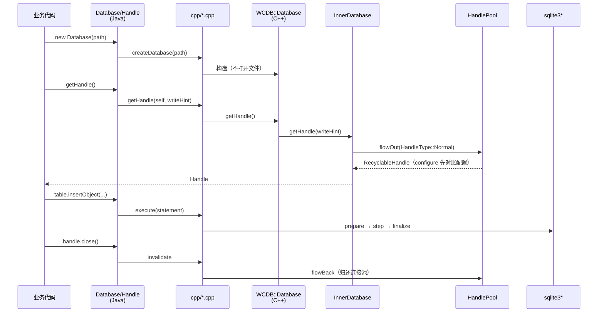

# 99 实战：在 Android 上跑通建表、CRUD 与事务

- **本课目标**：把前四课的东西落到一个能跑的 Android 工程上——依赖怎么引、ORM 怎么建表、CRUD 怎么写、事务怎么开、配置怎么调、出问题怎么看。
- **前置**：[01 总览](01-overview.md)、[02 核心架构](02-core-architecture.md)、[03 并发模型](03-concurrency.md)、[04 配置系统](04-config.md)。
- **预计用时**：60 分钟。
- **源码**：`src/java/main/src/main/java/com/tencent/wcdb/`（Java API）、`src/java/test/src/androidTest/java/com/tencent/wcdbtest/`（可参照的用法样例）、`src/java/builder/compiler/`（注解处理器）。
- **承接上节**：04 课讲到配置的「懒对账」，本课把它放进真实的调用序列里看。
- **本课要弄懂：从零建库到批量写入的完整链路是什么？**
- **结课语**：到这里五课结束。想再深入，两条路——一是看 `src/java/test/` 下的 androidTest，它覆盖了并发、修复、压缩、迁移的真实用例；二是读 `src/common/core/sqlite/`，那是 WCDB 对 SQLite 的全部改造点。

## 一、依赖与工程配置

WCDB 的 Android 侧由三部分组成：运行库、注解、注解处理器（外加一个 Gradle 插件）：

```groovy
// app/build.gradle
plugins {
    id 'com.android.application'
    id 'com.tencent.wcdb.gradle'      // 处理注解处理器的自动生成
}

dependencies {
    implementation 'com.tencent.wcdb:android'      // Database / Handle / Table ...
    implementation 'com.tencent.wcdb:annotation'   // @WCDBTableCoding / @WCDBField ...
}
```

插件 id 在 `src/java/builder/gradle-plugin/build.gradle` 里写死：

```groovy
gradlePlugin {
    plugins {
        wcdbPlugin {
            id = 'com.tencent.wcdb.gradle'
            implementationClass = 'com.tencent.wcdb.gradle.WCDBPlugin'
        }
    }
}
```

## 二、ORM 模型：注解生成一个编码类

注解只有两类，且处理器只认第一个：

```java
// src/java/annotation/src/main/java/com/tencent/wcdb/WCDBTableCoding.java
@Inherited
@Target(ElementType.TYPE)
@Retention(RetentionPolicy.SOURCE)
public @interface WCDBTableCoding {
    MultiIndexes[] multiIndexes() default {};
    MultiPrimary[] multiPrimaries() default {};
    boolean isWithoutRowId() default false;
}
```

```java
// src/java/annotation/src/main/java/com/tencent/wcdb/WCDBField.java
public @interface WCDBField {
    String columnName() default "";
    boolean isPrimary() default false;
    boolean isAutoIncrement() default false;
    boolean enableAutoIncrementForExistingTable() default false;
    boolean isUnique() default false;
    boolean isNotNull() default false;
    boolean isNotIndexed() default false;
}
```

注解处理器的入口在 `src/java/builder/compiler/`：

```java
// src/java/builder/compiler/src/main/java/com/tencent/wcdb/compiler/JavaAnnotationProcessor.java
@Override
public Set<String> getSupportedAnnotationTypes() {
    return Collections.singleton(WCDBTableCoding.class.getCanonicalName());
}
```

对**带注解的类**，生成一个同包的编码类，里面是字段引用与语句构造器。仓库自带的样例：

```java
// src/java/test/src/androidTest/java/com/tencent/wcdbtest/base/TestObject.java
@WCDBTableCoding
public class TestObject {
    @WCDBField(isPrimary = true, isAutoIncrement = true)
    public int id;

    @WCDBField
    public String content;
}
```

生成后就可以写 `DBTestObject.id.gt(...)` 这种类型安全的列引用——这是 WINQ 的入口。

## 三、建库 → 建表 → CRUD（图 9-1）

```java
// 参照 src/java/test/.../database/HandleTest.java
Database database = new Database(path);
if (!database.canOpen()) {
    return;                       // 懒初始化：现在还没打开文件
}

Handle handle = database.getHandle();
handle.createTable(tableName, binding);          // 需要 TableBinding
Table<TestObject> table = handle.getTable(tableName, binding);

table.insertObject(new TestObject());            // 单条
database.insertObjects(objects, DBTestObject.allFields(), tableName);   // 批量
table.deleteObjects(DBTestObject.id.gt(lower).and(DBTestObject.id.lt(upper)));
table.updateValue("abc2", DBTestObject.content,
                  DBTestObject.id.gt(lower).and(DBTestObject.id.lt(upper)));
List<TestObject> list = handle.getAllObjects(DBTestObject.allFields(), tableName);
```



> 图 9-1：一次「建库 → 取 handle → 写入 → 归还」的完整链路。C++ 与 Java 的类名一一对应，
> 但生命周期只在 Java 侧管理（`Handle.close()` 触发 `invalidate`）。

### 语句的三种准备方式（02 课，这里给落地写法）

| 方法 | 语义 | 什么时候用 |
| --- | --- | --- |
| `getOrCreatePreparedStatement` | 复用缓存的 `sqlite3_stmt` | 反复执行同一 SQL |
| `prepareNewStatement` | 新建，不占用主语句 | 一条 handle 上并发跑多条查询 |
| `preparedWithMainStatement` | 占用**主语句**槽位 | 需要与主语句互斥的长查询 |

`prepareNewStatement` 用完必须 `finalizeAndReturnPreparedStatement`；整条 handle 收工时用
`finalizeAllStatements`。

## 四、事务：两种写法，一套内核

**写法一：`Transaction` 回调**（推荐，自动 commit/rollback）：

```java
// 出自 src/java/test/.../database/HandleTest.java
database.runTransaction(new Transaction() {
    @Override
    public boolean insideTransaction(@NotNull Handle handle) throws WCDBException {
        table.updateValue("abc2", DBTestObject.content,
                DBTestObject.id.gt(lower).and(DBTestObject.id.lt(upper)));
        return true;          // true = commit，false = rollback
    }
});
```

`Transaction` 接口本体只有**一个方法**：

```java
// src/java/main/src/main/java/com/tencent/wcdb/core/Transaction.java
public interface Transaction {
    boolean insideTransaction(@NotNull Handle handle) throws WCDBException;
}
```

**写法二：显式 begin/commit/rollback**（`HandleOperation`）：

```java
handle.beginTransaction();
try {
    /* ... */
    handle.commitTransaction();
} catch (WCDBException e) {
    handle.rollbackTransaction();
}
```

嵌套事务走**保存点**（03 课：`m_transactionLevel > 1` 时翻译成 `RELEASE savepoint`），
所以 `runTransactionIfNotInTransaction` 在已有事务里会直接执行回调而不再 begin。

### 兼容层：如果你要从 `SQLiteDatabase` 迁过来

`src/java/compat/` 提供与 Android 原生 `SQLiteDatabase` 同名的 API，事务方法是**标志位式**的：

```java
// src/java/compat/src/main/java/com/tencent/wcdb/compat/SQLiteDatabase.java
public void beginTransaction()                 { ... }
public void beginTransactionNonExclusive()     { ... }
public void beginTransactionWithListener(SQLiteTransactionListener listener) { ... }
public void endTransaction()                   { ... }
public void setTransactionSuccessful()         { ... }
public void execSQL(String sql)                { ... }
```

迁移期的用法与原生 `SQLiteDatabase` 完全一致：`beginTransaction` → 干活 → `setTransactionSuccessful` →
`endTransaction`。

## 五、Android 上必须知道的运维接口

这些都在 `Database.java` 上，直接对应 03/04 课讲的机制：

```java
database.getNumberOfAliveHandle();        // 连接池里活着的 handle 数
database.purge();                          // 回收空闲 handle
Database.purgeAll();                       // 全局回收
Database.releaseSQLiteMemory(int bytes);  // 归还 SQLite 内存
Database.setSoftHeapLimit(long limit);    // SQLite 软堆上限
database.vacuum(progressMonitor);          // 手动回收空间
database.incrementalVacuum(int pages);     // 增量 vacuum
database.enableAutoVacuum(true);           // PRAGMA auto_vacuum = INCREMENTAL
database.enableAutoCheckpoint(true);       // 默认已开启
database.enableAutoBackup(true);            // 产 -first.material / -last.material
database.enableAutoMigration(true);
database.enableAutoCompression(true);
database.blockade(); database.unblockade(); database.isBlockaded();
database.removeFiles();                    // 删库
database.moveFile(destination);
```

**长查询可中断**：`Handle.CancellationSignal`

```java
Handle.CancellationSignal signal = new Handle.CancellationSignal();
signal.attachCancellationSignal(handle);
/* 另一线程 signal.cancel(); */
signal.detachCancellationSignal();
```

这背后是 `sqlite3_progress_handler`（03 课）。做导入、批量迁移这类长任务时一定要有。

## 六、配置在 Android 上怎么用

```java
database.setConfig("demo", invocation, ConfigPriority.Highest);
```

`ConfigPriority` 与 C++ 的 `Priority` 对齐：`Highest` 只留给加密。加密：

```java
database.setCipherKey(key);                    // 默认页大小 / 默认版本
database.setCipherKey(key, 1024);              // 打开非 WCDB 建的加密库
database.setCipherKey(key, 4096, CipherVersion.Version3); // WCDB 1.0.x 建的库
Database.setDefaultCipherVersion(CipherVersion.Version4);
```

04 课的四条坑（页大小、`Version3`、`Priority::Highest`、懒生效）在 Java 侧一个不少。

## 七、常见坑

1. **`canOpen()` 为 false 就继续用**：懒初始化意味着构造成功不代表能打开，必须检查。
2. **在事务里 `getHandle()` 拿第二个 handle**：事务绑定在 handle 上，换一个 handle 就是另一个
   事务；跨 handle 看不到未提交数据。
3. **忘了 `finalizeAndReturnPreparedStatement`**：`prepareNewStatement` 创建的语句不归还，
   handle 的语句槽会一直占着，直到 `invalidate`。
4. **以为 `Handle.close()` 会关闭数据库**：它只是 `invalidate`，把 handle 还给连接池；数据库要
   `database.close()`。
5. **`setConfig` 之后立刻期望当前 handle 生效**：正在执行的 handle 不会立即应用，下一个 handle
   首次操作前才生效。
6. **加密库页大小传错 / 版本没设 `Version3`**：见第五节，表现为读不到数据或 `SQLITE_NOTADB`。
7. **多线程各自 `new Database(samePath)` 以为会打开多个库**：同路径共享同一个
   `InnerDatabase`（`CommonCore::getOrCreateDatabase`），这是特性不是 bug。
8. **用 `enableLiteMode(true)` 之后还想备份**：lite 模式不能回滚、不能备份。

## 八、自测题

1. `new Database(path)` 之后调 `canOpen()` 与 `isOpened()` 有什么区别？为什么两个都要有？
2. `handle.getTable(...)` 与 `handle.createTable(...)` 都在 `HandleORMOperation` 上，为什么建表也
   放在 handle 而不是 database 上？（提示：建表要在事务里）
3. `Transaction.insideTransaction` 返回 `false` 之后，内核会执行什么？结合 03 课的
   `commitOrRollbackTransaction` 说明。
4. `runTransactionIfNotInTransaction` 与 `runTransaction` 的行为差异是什么？它在嵌套场景下省了哪一步？
5. `PausableTransaction` 相比 `Transaction` 多一个 `isNewTransaction` 参数，它服务于什么场景？
   对应 03 课的哪个循环（提示：`runPausableTransactionWithOneLoop`）？
6. （动手）在 `src/java/test/` 下找出至少 3 个使用 `runTransaction` 的测试类，说明它们分别在
   验证什么行为。
7. （动手）在 `Database.java` 里统计 `public` 方法数量，并按「生命周期 / 句柄管理 / 维护任务 /
   配置」四类归组，验证 02 课的分层在 Java 侧是否成立。
8. （动手）给一个类加 `@WCDBTableCoding` 与 `@WCDBField(isPrimary=true, isAutoIncrement=true)`，
   编译后找到自动生成的编码类，指出它相对于原类**新增**了哪些静态成员（字段引用、
   `allFields()` 等），并说明 WINQ 的 `id.gt(...)` 是怎么做到类型安全的。
